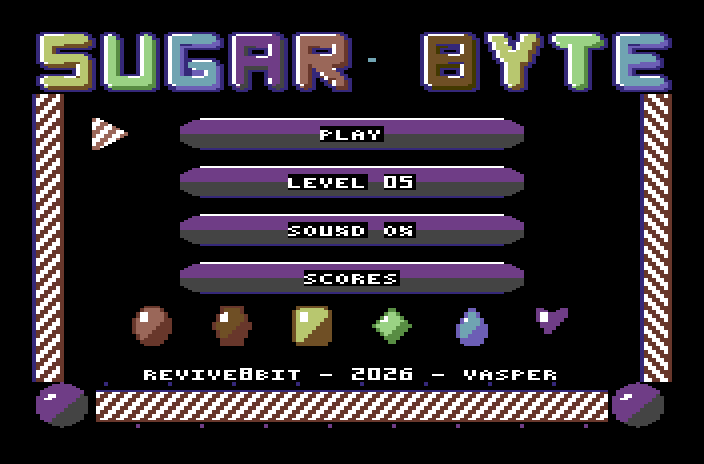
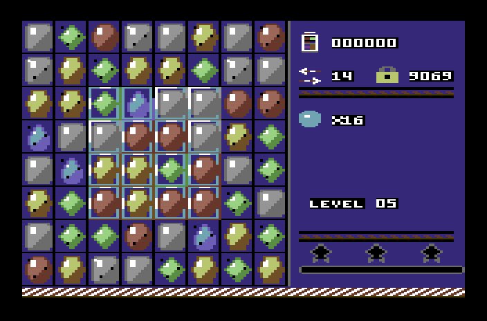
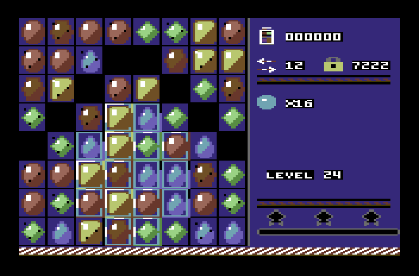
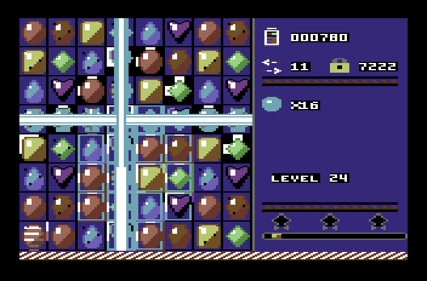

# Sugar Byte — Commodore 64

**Sugar Byte** is a match-3 game for the **Commodore 64** (PAL), written in **6510 assembly**. It is the C64 version
of the [Amstrad CPC game](../SugarByteCPC): the same rules, levels, codes, graphics and sounds, rebuilt for the
C64's hardware.

**Player's manual:** [English](manual.md) ([PDF](docs/manual-en.pdf)) · [Ελληνικά](manual.el.md)
([PDF](docs/manual-el.pdf))

| | |
|---|---|
|  |  |
|  |  |

## The game

Swap two neighbouring candies to line up three or more of a colour. Lines of 4 make a **striped** candy (it clears
its row or column), an L or a T a **wrapped** one (a 3×3 blast), 5 in a row a **colour bomb** (swapped with a
candy, it pops every candy of that colour). Two specials swapped together combine: striped + striped a row and a
column, striped + wrapped a cross three wide, wrapped + wrapped 5×5, bomb + striped/wrapped turns a whole colour
into that special, bomb + bomb clears the board.

**60 levels** (`levels/levels.txt`, the CPC's): reach a score, clear the **jelly** (one or two layers), bring the
**ingredients** (cherry, nut) down to the bottom, or both, within a number of moves; 1–3 stars by the points.
**Icing** (3 layers), **chocolate** (it spreads if you break none in a move), **licorice** and **holes** shape the
boards; candies slide diagonally around them. Moves left over at a win become striped candies that all go off: the
**Sugar Crush**. Every level has a 4-digit **code** (shown in the HUD; at a win the next level's): LEVEL in the menu
takes you back there. After 5 seconds idle a move wiggles as a hint; a board with no move is shuffled.

Controls: joystick in port 2 (or 1), or the cursor keys / W A S D; fire, SPACE or RETURN selects and swaps;
**M** music on/off; **RUN/STOP** (or ←) back to the menu. In the code entry: left/right a digit, up/down its value,
fire accepts, RUN/STOP cancels.

## On the C64

- **Multicolour bitmap**, 160×200: the CPC's Mode 0 pixel is as wide as the C64's multicolour one, so the art
  (`assets/cpc/`, the CPC's sheets) is used as is — a 12×24 candy is exactly 3×3 characters. `tools/mkgfx64.py`
  reduces every character to the C64's 3 colours + background and maps the CPC's 16 pens to the C64 palette.
- The board (8×8 cells) on the left, the HUD on the right — as on the CPC, minus the overscan borders — and a
  candy cane at the bottom whose stripes run. The menu has the title, whose letters cycle through the colours.
- Candies are composed over their cells character by character (the cell's grid and the jelly keep their colour
  where the candy leaves it free); they **fall** in steps of 8 lines, fewer steps the more there is to fall.
- **Sprites** for the cursor and the selection, and for the candies that move freely: the swap, the hint's wiggle,
  the diagonal slide (a multicolour sprite with a hires one behind it for the shade).
- **SID music**, written for the C64 from the CPC's tune (C major): a game tune with lead, filtered bass, drums and
  arpeggios (A from the CPC, a new B section), a calm menu tune; the CPC's effects on voice 3 (the pop rises with
  the chain). **Speech**: "Sugar Byte!", "Sweet!", "Delicious!", "Sugar Crush!" as 4-bit samples on the SID's
  volume register (with the voices held at a constant level, so the 8580 speaks too).
- Best points and stars per level, by page (SCORES), for as long as the machine is on.

## Build & run

```bash
make            # build/sugar.d64 (disk) and build/sugar.tap (tape)
make run        # x64sc with the disk autostarted
make test       # headless tests in VICE (binary monitor)
make gfx        # src/data/ from assets/, levels/, music/, voice/ (and build/mockup_*.png)
make screenshots    # docs/screenshots/*.png and the manual's pictures
make manuals    # docs/manual-en.pdf, docs/manual-el.pdf (needs fpdf2)
```

- Disk: `LOAD"SUGAR",8` and `RUN`.
- Tape: `LOAD` and `RUN` (or SHIFT+RUN/STOP). A small boot file loads at the KERNAL's speed, then a turbo loader
  reads the game (about 1 minute 50 seconds of tape in all; the screen is off while it loads, the border flickers).

Requirements: [64tass](https://sourceforge.net/projects/tass64/), VICE 3.9 (`x64sc`, `c1541`), Python 3 with
Pillow, `ffmpeg` (the speech).

## Layout

```
src/        6510 sources: main (IRQ, loop), video (bitmap, cells, sprites), input, board (matches,
            gravity, the fall), special, cells, ingred, level, codes, game (the states), hud, menu,
            sound (the SID player), voice, tapeboot (the tape's turbo loader)
assets/cpc/ the CPC's graphics (sheets, the source of everything drawn)
levels/     the levels (the CPC's)
music/      SID instruments, tunes, effects
voice/      the phrases (WAV)
tools/      converters (graphics, levels, music, speech, tape), screenshots
tests/      headless VICE tests
```

---

**REVIVE8BIT · 2026 · VASPER**
