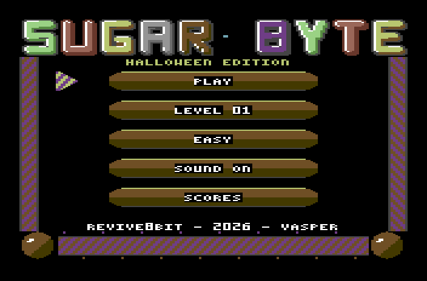
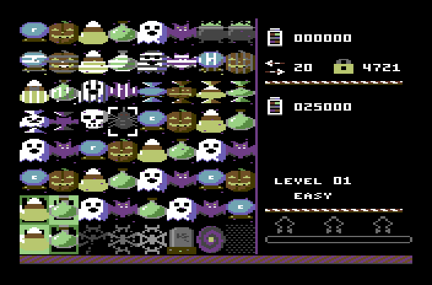
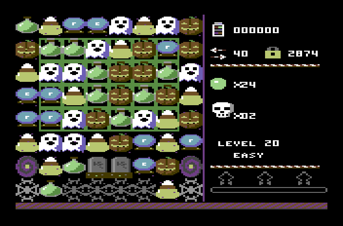
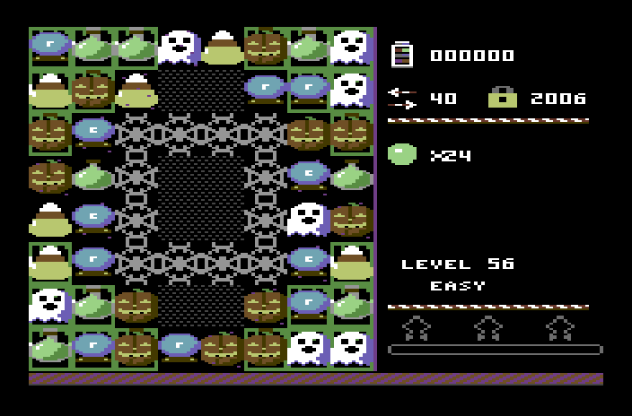
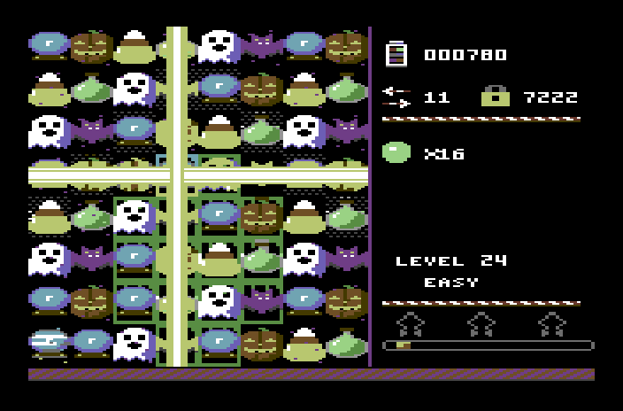
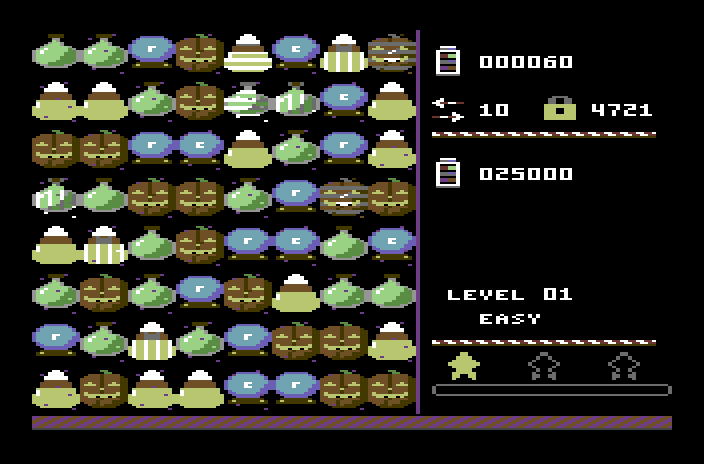

# Sugar Byte — Halloween edition (Commodore 64)

**Sugar Byte** dressed up for the night of the 31st: the same game — sixty
levels, three difficulties, the specials, codes, disk and tape — with
jack-o'-lanterns, ghosts and bats on a black board, Grieg and Bach on the SID,
thunder for the bombs and a voice from the crypt.

| | |
|---|---|
|  |  |
|  |  |
|  |  |

## What's different

**The candies** (drawn for this edition, `tools/mkart.py`), told apart by
shape and by colour on the C64's palette:

| | | |
|---|---|---|
| a **crystal ball** (cyan) | a **jack-o'-lantern** (orange) | a **candy corn** (yellow) |
| a **witch's potion** (green) | a **ghost** (white) | a **bat** (purple) |

Striped candies wear white stripes (the ghost, dark grey ones), wrapped ones a
twist of paper. The **colour bomb** is a bubbling cauldron; the
**ingredients** are a **skull** and a **spider**.

**The board** is the night: black, every other square with a few purple stars.
The **jelly** is green **slime** (one or two layers), the **icing** a
**cobweb** (three layers, thinner each time), the **chocolate** a
**tombstone**, the **licorice** a witch's **spiral**, a **hole** is fog. The
pops, beams and stars burn candle-yellow; the canes are orange and purple,
with pumpkins in the corners; the title's letters cycle through pumpkin,
witch, slime, blood, candle and bone; the border blinks orange when the moves
run out.

**The music** (`music/`), arranged for the SID from two public-domain classics:

- **In game: "In the Hall of the Mountain King"** (Grieg, *Peer Gynt*, 1875),
  in A minor — the theme creeps in on a reedy bassoon over pizzicato bass
  through the filter, then returns an octave up on a saw, with drums, minor
  and major arpeggios, and a thunder roll at the end of the phrase.
- **In the menu: the Toccata in D minor** (BWV 565) — the famous flourish on a
  two-rank organ, high, middle and low, its echo an octave down, a pedal drone
  through the filter, the diminished chord rolling up to D minor; then four
  bars of broken chords over the pedal.

**The effects** (`music/sfx.txt`): a tritone for a selection, a creaking door
for the swap, a witch's zap for the beams, a blast for the wrapped candy,
**thunder** for the colour bomb, whole-tone runs for the pops (a step higher
with every link of the chain), a ghost's sliding *"wooo"* when the moves run
out, a minor arpeggio that ends on a major chord for a win.

**The voice** (`voice/`, `tools/voice_tts.sh`): *"Happy Halloween!"* at the
start, *"Spooky!"* and *"Frightful!"* for long chains, *"Sugar Crush!"* — a
deeper voice with a short echo, as from a crypt; 4-bit samples on the SID, as
in the game.

The rules, the levels (`../levels/levels.txt`), the codes, the difficulties and
the manual ([English](../manual.md), [Ελληνικά](../manual.el.md)) are the
game's.

## Build & run

```bash
make            # build/sugar.d64 (disk) and build/sugar.tap (tape)
make run        # x64sc with the disk autostarted
make test       # the game's headless tests, on this edition
make art        # assets/ from tools/mkart.py (and build/preview_*.png)
make screenshots    # docs/*.png
```

(or `make halloween` in the directory above). Disk: `LOAD"SUGAR",8` and `RUN`;
tape: `LOAD` and `RUN` — it is found as **SUGAR HALLOWEEN**.

## How it is made

There is one game: `../src`. This directory brings only what the edition
changes, and its Makefile copies the code to `build/src` and builds it with its
own data:

```
theme.py        the look, for ../tools/mkgfx64.py --theme: the colours (black
                board, purple seam, yellow selection), the pen maps of the
                game's sheets, its own sheets, the menu's "HALLOWEEN EDITION"
tools/mkart.py  the candies and the cells, drawn in C64 colours
assets/         what mkart.py draws (candy_sheet, cells_sheet: png + json)
music/          instruments, the two tunes, the effects (../tools/mkmusic64.py)
voice/          the four phrases (WAV); tools/voice_tts.sh made them
tools/screenshots.py   docs/*.png
```

The colours that the code itself sets (`BOARD_BG`, `MENU_BG`, `OVER_FLASH`,
`HUD_SEAM`, `SELECT_COL`) come from the theme too, through `data/gfx.inc`.

---

**REVIVE8BIT · 2026 · VASPER**
