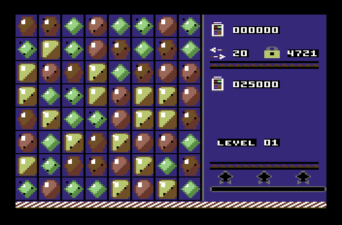
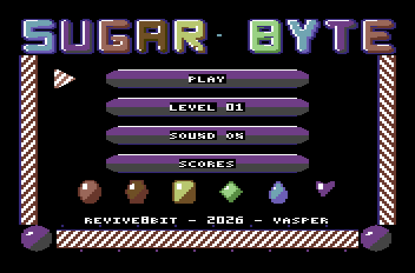
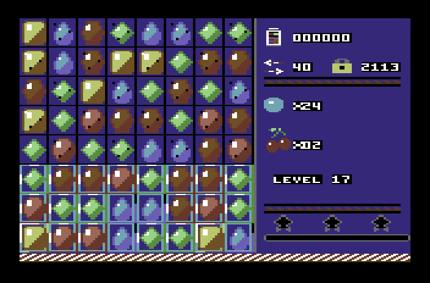
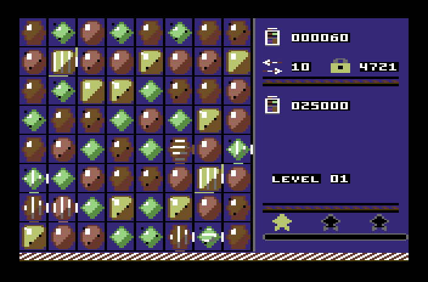
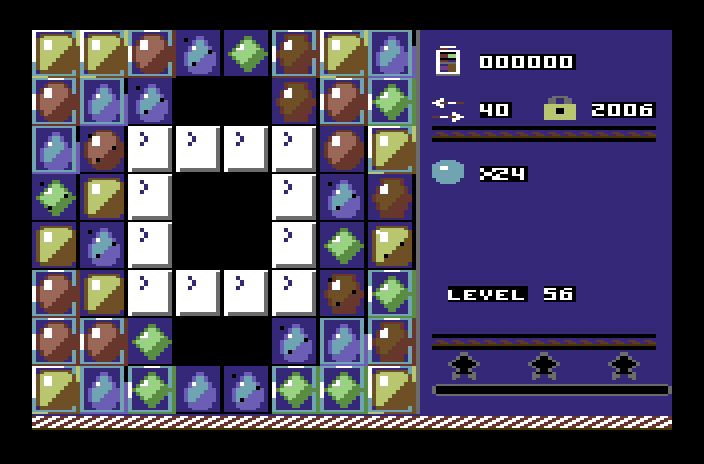

# SUGAR BYTE

**COMMODORE 64 · DISK · CASSETTE · PAL**

*A REVIVE8BIT production · VASPER · © 2026*

> Ελληνικά: [manual.el.md](manual.el.md)

---

## ★ YOUR C64 HAS A SWEET TOOTH ★

**Sixty boards. Six candies. One very hungry Commodore.**

Swap two sweets, line up three, and watch the board go **pop**. Line up four
and you get a **striped candy** that wipes out a whole row. Make an L and you
get a **wrapped candy** that blows up everything around it. Line up five and
you get the **colour bomb** — swap it with any candy and every candy of that
colour on the board disappears at once.

And your C64 has never sounded this sweet:

- **IT TALKS.** *"Sugar Byte!" "Sweet!" "Delicious!" "Sugar Crush!"* — real
  digitised speech straight out of the SID. No speech cartridge, no add-ons —
  and it speaks on old and new SIDs alike.
- **SID MUSIC.** A bouncy game tune with lead, filtered bass, drums and
  arpeggios, and a gentle flute-and-harp tune for the menu. Every pop sings a
  little higher as your chain grows.
- **SMOOTH MOVES.** Candies glide into each other's place, wiggle when you need
  a hint, and slide diagonally around the gaps — hardware sprites at work.
- **SUGAR CRUSH!** Finish a level with moves to spare and every leftover move
  turns into a striped candy — then they all go off at once.
- **SIXTY HAND-MADE LEVELS** — jelly to clear, icing to crack, chocolate that
  spreads, licorice that won't budge, cherries and hazelnuts to bring home, and
  boards shaped like diamonds, hourglasses and rings, where candies slide
  diagonally around the gaps.

**SUGAR BYTE.** *The sweetest thing that ever happened to your breadbin.*



---

## LOADING

### From disk

1. Switch on your C64 and the disk drive.
2. Put the disk in the drive, label side up.
3. Type

   ```
   LOAD"SUGAR",8
   ```

   and press `RETURN`. When the `READY.` prompt comes back, type `RUN` and
   press `RETURN`.
4. You'll hear *"Sugar Byte!"* and the main menu appears.

### From cassette

1. Rewind the tape to the start.
2. Hold `SHIFT` and press `RUN/STOP`, then press `PLAY` on the Datassette.
3. The C64 finds **SUGAR BYTE** and loads a small loader at the normal speed
   (press the `C=` key to skip the wait after `FOUND`). Then the screen goes
   blank and the border flickers with colour: that's the **turbo loader**
   reading the game.
4. Loading takes about two minutes in all. Then you'll hear *"Sugar Byte!"*
   and the main menu appears.

*If the border turns solid red, the tape didn't read cleanly: rewind and load
again.*

*Sugar Byte runs on any PAL Commodore 64 or 64C, with either SID.*

---

## THE MAIN MENU



Move the striped pointer with the **joystick** or the **cursor keys**, and
choose with **FIRE**, **SPACE** or **RETURN**.

| | |
|---|---|
| **PLAY** | Start the level shown under it. |
| **LEVEL NN** | Enter a **level code** to jump to a level you've reached before (see *Level codes*). |
| **SOUND ON / OFF** | Turn the music on or off. |
| **SCORES** | Your best score and stars for every level. Twenty levels to a page: **left** and **right** turn the page, **FIRE** or **RUN/STOP** goes back. |

---

## HOW TO PLAY



The board is 8 × 8. Move the cursor with the **joystick** or the **cursor
keys** and press **FIRE** / **SPACE** to pick up a candy — it gets a cyan
frame. Then pick a candy right **next to it** (left, right, above or below)
and the two swap places.

- If the swap makes a line of **three or more of the same colour**, across or
  down, they pop. The candies above fall to fill the gap and new ones drop in
  from the top. If the falling candies make new lines, those pop too — that's
  a **chain**, and every link in the chain multiplies your points.
- If the swap doesn't make a line, the candies swap back and it doesn't cost
  you a move.
- Pick the same candy again to drop it. Pick one further away and your
  selection jumps to that one instead.

Every swap that works uses up **one move**. The moves left are shown next to
the two arrows in the panel on the right.

**Stuck?** Wait five seconds without touching anything and two candies will
start to wiggle towards each other — that's a move you can make. If there are
no moves left on the whole board at all, the board is shuffled for free.

| Control | |
|---|---|
| Joystick (port 2 or 1), cursor keys, W A S D | Move the cursor (cursor up and left with `SHIFT`) |
| FIRE / SPACE / RETURN | Pick up, swap |
| M | Music on / off |
| RUN/STOP or ← | Back to the menu |

---

## THE PANEL

From top to bottom:

- **The jar** — your score.
- **The arrows** — moves left. **The padlock** — this level's code.
- **The goal** — what you need to do to win the level: points to reach, jelly
  squares left to clear, ingredients left to bring down.
- **LEVEL NN** — the level you're on.
- **Three stars** and the **progress bar** — they light up as your score
  passes each star's target.

---

## THE GOALS

Every level has a limited number of moves and one goal:

- **SCORE** — reach the target score.
- **JELLY** — clear every jelly square. Jelly sits **under** the candies; it
  goes when a candy pops on top of it. Double jelly needs two pops.
- **INGREDIENTS** — bring the cherries and hazelnuts down to the bottom. They
  don't match and don't pop: clear the candies underneath them and they fall.
  They leave the board when they reach the bottom row — **or when they sit
  right on top of a gap**.
- **JELLY + INGREDIENTS** — both at once.

Reach the goal and you win, however many moves you have left. Then comes
**Sugar Crush**: every move you didn't use turns a random candy striped, and
then everything goes off at once, for points.



When the level is won, the stars you earned appear on the board: **one** for
winning, **two** and **three** for higher scores. Press **FIRE** to go on to
the next level, with its code shown in the panel.

If you run out of moves first, the border flashes. Press **FIRE** to try the
same level again, or **RUN/STOP** for the menu.

---

## SPECIAL CANDIES

| Line up | You get | It does |
|---|---|---|
| 4 in a row | **Striped candy** | When it pops, it clears its whole row — or its whole column — with a beam. |
| An L or a T shape | **Wrapped candy** | When it pops, it blows up the 3 × 3 square around it. |
| 5 in a row | **Colour bomb** | Swap it with any candy: every candy of that colour pops. |

A special candy appears where you made the move, and it pops when it's part of
a line — or when another special candy hits it.

**Swap two special candies together** for something much bigger:

| Swap | Effect |
|---|---|
| Striped + striped | A whole row **and** a whole column. |
| Striped + wrapped | A cross three candies wide. |
| Wrapped + wrapped | A 5 × 5 explosion. |
| Bomb + striped | Every candy of that colour turns striped — and they all go off. |
| Bomb + wrapped | Every candy of that colour turns wrapped — and they all go off. |
| Bomb + bomb | The whole board. |

---

## WHAT'S ON THE BOARD

| | |
|---|---|
| **Jelly** | Under the candies. Pop a candy on top to clear one layer. |
| **Icing** (1–3 layers) | A block. Each line popped next to it, or a special candy's beam, breaks one layer. |
| **Chocolate** | A block that **spreads**: if you finish a move without breaking any chocolate, it grows onto a candy next to it. |
| **Licorice** | A block that breaks the way icing does. |
| **Gaps** | Holes in the board. Nothing ever goes there. |

Candies can't fall **through** a block or a gap. Instead they **slide
diagonally** around it: an empty square that nothing can reach from above takes
the candy from the square above-left or above-right. So even the oddest-shaped
boards fill up again — and blocks hold their shape until you break them.



---

## SCORING

| | Points |
|---|---|
| A line of 3 | 60 |
| A line of 4 | 120 |
| A line of 5 | 200 |
| Each candy hit by a special | 60 |
| Each layer of jelly | 100 |
| Each ingredient brought down | 1,000 |

**Everything is multiplied by the chain:** the first pop counts once, the pops
caused by falling candies count twice, the next ones three times, and so on.
A long chain also gets a *"Sweet!"* — and a really long one, *"Delicious!"*

---

## LEVEL CODES

Every level has its own four-digit code. It's shown next to the **padlock** in
the panel while you play, and when you win a level the panel shows the code for
the **next** one. Write them down.

To use a code, choose **LEVEL NN** in the menu and press **FIRE**. The plate
turns into `CODE 0000`:

- **left / right** pick a digit (it flashes),
- **up / down** change it,
- **FIRE** to accept, **RUN/STOP** to cancel.

A good code takes you straight to that level. A wrong one makes a sour noise
and lets you try again.

The first one's free: level 1 is **4721**.

*Best scores and stars are kept for as long as the computer stays on.*

---

## HINTS FROM THE KITCHEN

- **Play low.** Moves near the bottom of the board shake up everything above
  them and set off more chains than moves near the top.
- **Make special candies before you need them.** A line of four in the right
  place saves you three moves later.
- **Bring the ingredients down by their own column.** They only move when the
  squares right under them are cleared.
- **Never leave chocolate alone.** Break at least one piece every move, or it
  takes over.
- **Keep moves for the end.** Every move you don't use becomes a striped candy
  during Sugar Crush, and that's where the three stars are.

---

## CREDITS

**Design, code, graphics:** VASPER
**A REVIVE8BIT production · 2026**

Written in 6510 assembly with 64tass, from the Amstrad CPC original. Graphics
drawn for the CPC in CPCArt and converted to the C64's multicolour bitmap.
Music written for the SID. Speech generated on a PC and played back as 4-bit
samples through the SID's volume register.

---

*Sixty levels. Three voices. One sweet tooth.*

## **SUGAR BYTE — Pop it. Swap it. Crush it.**

*Available on disk and cassette for the Commodore 64.*
